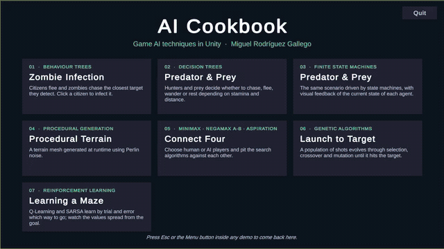
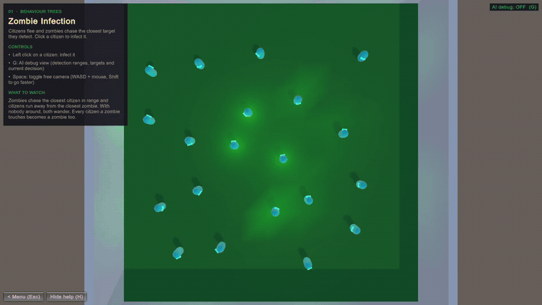
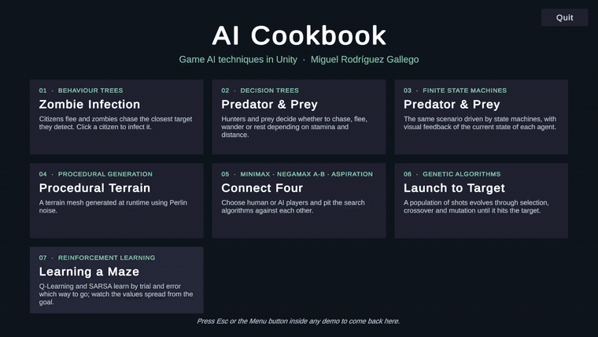
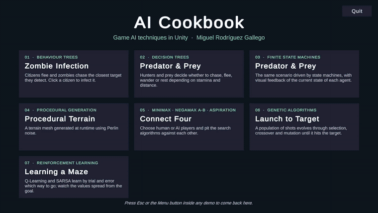
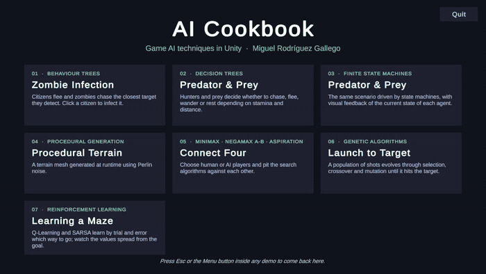

# AI Cookbook

[](https://github.com/miguelrg14/U_AI_Cookbook/actions/workflows/ci.yml)
[](https://unity.com/releases/editor/archive)
[](LICENSE)

Seven classic game AI techniques implemented in Unity (C#), all in one project and all launched from one menu: behaviour trees, decision trees, state machines, procedural generation, adversarial search, genetic algorithms and reinforcement learning.

### ▶ [Play it in the browser](https://miguelrg14.github.io/U_AI_Cookbook/)

<!-- Main menu capture. See "Recording the GIFs" at the bottom. -->


## Demos

| # | Technique | Demo | What to try |
|---|-----------|------|-------------|
| 01 | Behaviour Trees | Zombie infection | Click a citizen to infect it and watch the infection spread |
| 02 | Decision Trees | Predator & prey | Watch the prey's stamina decide between fleeing, watching and resting |
| 03 | Finite State Machines | Predator & prey | Same scenario as 02, driven by states and transitions instead |
| 04 | Procedural Generation | Perlin noise terrain | A terrain mesh built vertex by vertex at runtime |
| 05 | Minimax · Negamax α-β · Aspiration | Connect Four | Pit the algorithms against each other and press **G** to compare positions searched and time |
| 06 | Genetic Algorithms | Launch to target | Shots evolve through selection, crossover and mutation until they hit |
| 07 | Q-Learning · SARSA | Maze and cliff walking | Draw walls, move the goal and watch the values spread from it |

Every demo has a help panel (**H**) explaining what is happening and its controls, an AI debug view (**G**) showing each agent's current decision, detection ranges and target, and **Esc** to return to the menu.

| | |
|---|---|
|  |  |
|  |  |

## Highlights

- **Adversarial search (05).** Minimax, Negamax with alpha-beta pruning and aspiration windows share one board model and one symmetric evaluation function. Tests check that all three pick a move with the same value on random positions, and that alpha-beta searches far fewer positions to get it.
- **Reinforcement learning (07).** Tabular Q-Learning and SARSA on an editable grid, with a value heatmap, the greedy policy, a learning curve and live α/γ/ε controls. The cliff-walking map reproduces the textbook result (Sutton & Barto, example 6.6): Q-Learning learns the shortest path along the edge, while SARSA learns a safer route and earns more reward while it keeps exploring.
- **Shared agent architecture (01–03).** The three agent demos are built from the same pieces: stats, a two-range target detector with hysteresis so agents don't flicker between behaviours, a motor and a wander routine. Only the decision layer changes between them (behaviour tree, decision tree or state machine).
- **Modular project.** Each demo is its own assembly (`.asmdef`) and namespace. Demos only depend on `AICookbook.Shared`, never on each other.
- **Tested and built automatically.** EditMode tests run on every push with GitHub Actions ([GameCI](https://game.ci)), and pushes to `main` build the WebGL player and publish it to GitHub Pages.

## How to run

**In the browser:** [miguelrg14.github.io/U_AI_Cookbook](https://miguelrg14.github.io/U_AI_Cookbook/) (desktop browser, keyboard and mouse).

**In Unity:**

1. Open the `Proyecto/` folder with Unity Hub (Unity 6000.6.8f1).
2. Open `Assets/_Menu/Scenes/MainMenu.unity` and press Play.

## Tests

Window → General → Test Runner → EditMode → Run All.

| Assembly | Covers |
|----------|--------|
| `AICookbook.Shared.Tests` | Target detection ranges and hysteresis with real colliders, agent movement |
| `AICookbook.Minimax.Tests` | Connect Four rules; the search takes wins and blocks losses; Minimax, Negamax and Aspiration agree; alpha-beta visits fewer positions |
| `AICookbook.GeneticAlgorithms.Tests` | Population, selection, crossover (including a BLX-α regression test), mutation ranges, and a full run that must improve the population |
| `AICookbook.ReinforcementLearning.Tests` | Grid world rules, the Q-Learning update, the shortest path through the maze, and the cliff-walking result |

## Project structure

```
Proyecto/                       Unity project
  Assets/
    _Menu/                      Main menu, demo catalog, help panel and navigation
    _Shared/                    Code and art reused by several demos
      Scripts/Camera/           Free camera
      Scripts/DecisionSystem/   Actions, conditions, decision trees and state machines
      Scripts/Agents/           EntityStats, TargetDetectorBase, TwoRangeTargetDetector, AgentMotor, WanderRoutine
      Scripts/Debug/            AI debug view (G) and GL line drawing
      Scripts/UI/               Resolution-independent scale for IMGUI overlays
    01_BehaviourTrees/ ...      One folder per demo: scenes, scripts, prefabs, art and tests
Documentacion/                  Original course reports (Spanish) and the original console version of 07
.github/workflows/ci.yml        Tests, WebGL build and GitHub Pages deploy
```

```
AICookbook.Menu                   ─┐
AICookbook.BehaviourTrees         ─┤
AICookbook.DecisionTrees          ─┤
AICookbook.FiniteStateMachines    ─┼─►  AICookbook.Shared
AICookbook.Minimax                ─┤
AICookbook.ReinforcementLearning  ─┘

AICookbook.ProceduralGeneration, AICookbook.GeneticAlgorithms: standalone
```

**Adding a demo:** create its folder with its own `.asmdef` (referencing `AICookbook.Shared` if needed), add its scene to the Build Profile scene list and register it in `Assets/_Menu/Scripts/DemoCatalog.cs`.

## Background

These demos started as assignments for the game AI course of my degree in game design and development. For this portfolio I merged them into one project and reworked them:

- Rewrote the Connect Four search. The original never simulated the opponent's replies, and its evaluation function was not symmetric between players.
- Fixed a bug in the BLX-α crossover interval of the genetic algorithm.
- Fixed decision tree bugs: a hunter condition that always returned false, and the wrong prey being removed after a kill.
- Ported the reinforcement learning assignment from a console application to an interactive Unity demo and added SARSA next to Q-Learning.
- Extracted the code the demos had in common into a shared assembly, and added the menu, help panels, debug view, tests and CI.

## Credits

- **Decision system** (`_Shared/Scripts/DecisionSystem`): framework provided by the course for the decision tree and state machine assignments.
- **Connect Four base** (board and game manager): Martín Pérez Villabrille, as credited in the source files.
- **[SimpleJSON](https://github.com/Bunny83/SimpleJSON)** by Markus Göbel (Bunny83), MIT License.
- **Kenvector Future font** by [Kenney](https://kenney.nl), CC0.
- **Sound effects** (06) from [SoundBible.com](https://soundbible.com): "40 Smith Wesson 8x Gunshot" by Mike Koenig and "Battle Axe Swing".

Everything else: Miguel Rodríguez Gallego, [MIT License](LICENSE).

## Recording the GIFs

The images above are expected in `docs/media/`. To record them:

1. Play the WebGL build or the editor at 1280×720.
2. Record 5–10 seconds per demo with [ScreenToGif](https://www.screentogif.com) (Windows) or the Unity Recorder package.
3. Export at 10–15 fps and under ~5 MB each, using the names referenced in this README (`menu.gif`, `01_behaviour_trees.gif`, `02_decision_trees.gif`, `05_minimax.gif`, `07_reinforcement_learning.gif`).
